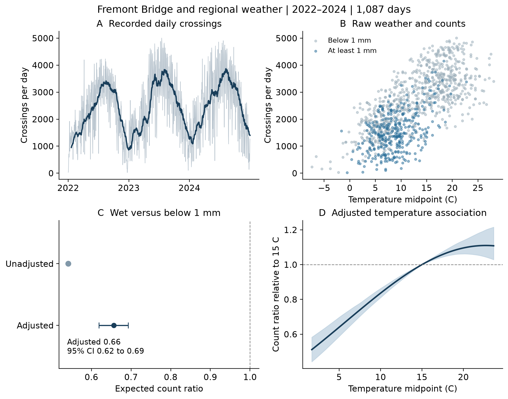
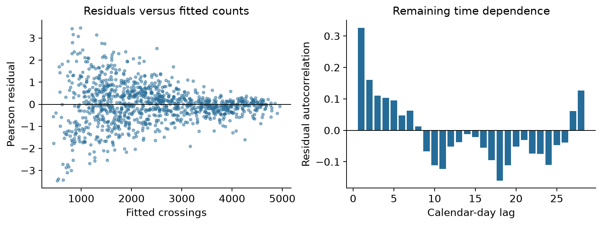

# Weather and micromobility crossings at Fremont Bridge

By **Guo Jinzheng**, for CISC7204 Practice 09.

## Research question and status

During 2022–2024, how are precipitation and temperature associated with recorded Fremont Bridge crossings after adjusting for calendar factors?

**Status: ongoing.** The preliminary analysis and figures are completed; future validation and model refinement remain ongoing. This is a curated portfolio version of the analysis previously uploaded in [my Assignment 01 repository](https://github.com/Guojinzhenguu6/CISC7204-MC650886-2026GitHub/tree/main/PreliminaryProjectProposal). It does not republish the entire assignment or its reports.

## Data sources and permission

- **City of Seattle / SDOT:** [Fremont Bridge counter dataset, 65db-xm6k](https://data.seattle.gov/d/65db-xm6k). Its archived official metadata (`data/counter_metadata.json`, `license.name`) marks the dataset **Public Domain**. The source contains hourly aggregate counts, not individual journeys or personal records.
- **NOAA / NCEI:** [GHCN Daily station USW00024233](https://www.ncei.noaa.gov/cdo-web/datasets/GHCND/stations/GHCND:USW00024233/detail), Seattle–Tacoma Airport. [NOAA's usage guidance](https://www.noaa.gov/office-education/outreach-communication/faq#using-noaa-content) identifies NOAA data as public domain; credit is retained. [Record layout and data flags](https://www.ncei.noaa.gov/pub/data/ghcn/daily/readme.txt).

The archived snapshots were retrieved on 18 September 2026. `data/source_manifest.json` records URLs, file sizes and SHA-256 checksums. No credentials or individual-level data are needed. The analysis and figures are student-derived outputs, not official Seattle or NOAA findings, and imply no endorsement.

## Methods and tools

Python, pandas, NumPy, Matplotlib, SciPy, statsmodels and Patsy. Validate hourly totals, aggregate by date, decode NOAA flags/units, join observations, audit missingness, then fit a negative-binomial count model with wet-day status, quadratic temperature, month, year, weekday and federal-holiday controls. Use a circular moving-block bootstrap (300 primary attempts, 14-day blocks), with sensitivity checks for block length, clock-transition days, low counts and precipitation specification.

## Key findings

The archived analysis retains **1,087 of 1,096 calendar days**. On days with at least 1 mm precipitation, the adjusted expected-count ratio is **0.656** compared with days below 1 mm (**95% block-bootstrap interval: 0.619–0.693**), about **34.4% fewer crossings** conditional on the model. The adjusted 20°C versus 15°C ratio is **1.096** (interval **1.062–1.139**). Raw wet-day and below-1-mm means are approximately 1,528 and 2,822 crossings per day.



The dashboard separates raw observations from adjusted comparisons. Temperature is the midpoint of daily maximum and minimum; below 1 mm can include light rain. Count ratios concern crossings, not unique riders.



The diagnostics reveal remaining time dependence (lag-one residual autocorrelation about 0.326). This supports caution when interpreting uncertainty and motivates further validation.

## Limitations

This observational study cannot establish causation. A single bridge and airport weather proxy limit generalization. Sensor issues, observation-window differences, omitted events and seasonal model assumptions can affect estimates. Bootstrap intervals do not eliminate confounding. In-sample fit is descriptive, not an out-of-sample forecast.

## Reproduce the analysis

Use Python 3.12 and run these commands from the repository root:

```sh
python3 -m venv .venv
source .venv/bin/activate
python -m pip install -r requirements.txt
python run_analysis.py
```

On Windows activate with `.venv\Scripts\activate` instead. The script runs every code cell in `analysis.ipynb` and regenerates figures, tables and `results/analysis_summary.json`. The full bootstrap can take several minutes. Alternatively install JupyterLab in that environment, open `analysis.ipynb` from the repository root, and restart the kernel and run all cells.

All source snapshots are included, so analysis runs offline after installing dependencies. Missing files trigger downloads from the manifest; changed upstream bytes fail checksum validation rather than silently changing the study. Preserve the snapshots for exact reproduction. Requirements record the environment used for the portfolio reproduction check.

## Organization

`analysis.ipynb`: analysis and saved outputs; `run_analysis.py`: command-line reproduction; `data/`: attributed source snapshots and manifest; `results/`: computed tables and two figures.

AI assisted with portfolio documentation and verification. The full analysis was reproduced using `run_analysis.py` on 14 October 2026; findings and figures were generated from the archived observations.
